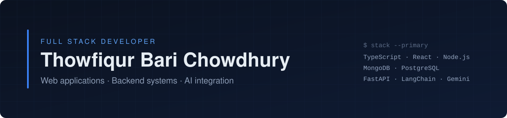

  

  
  
  

<b>I build complete web applications, reliable backend systems, and practical AI features.</b>

---

### About

I'm a Computer Science and Engineering student at **Shahjalal University of Science and Technology (SUST)**, Sylhet, and a full stack developer at a software agency.

- Build end-to-end web apps with **React / Next.js** on the frontend and **Node.js / Express** on the backend, written in **TypeScript**
- Design **REST APIs**, data models, and authentication with role-based access on **MongoDB** and **PostgreSQL**
- Integrate **LLMs** into real products: Gemini-assisted features, retrieval-augmented generation (RAG), and automation workflows
- Interested in scalable web architecture, software engineering practice, and open-source work

### Tech stack

**Languages**

**Frontend**

**Backend**

**Databases**

**AI and machine learning**

LangChain · Google Gemini API · RAG (hybrid retrieval, reranking) · ChromaDB · FAISS · Sentence Transformers · Pandas

**Tools and platforms**

Cloudinary · Render · MongoDB Atlas · n8n · Socket.IO · Streamlit

---

### Featured projects

<table>
<tr>
<td width="50%" valign="top">

#### [HalkaBite](https://github.com/thowfique041/HalkaBite)
Multi-role food delivery platform for customers, restaurants, delivery partners, and admins.

- Ordering, payments verification, reviews, campaigns, and analytics
- Real-time order and chat updates with server-sent events
- Gemini-assisted food recommendations grounded in database records

`React` `TypeScript` `Redux Toolkit` `Express` `MongoDB` `JWT` `Gemini`

[Live demo](https://halka-bite.vercel.app) · [Code](https://github.com/thowfique041/HalkaBite)

</td>
<td width="50%" valign="top">

#### [Dental Clinic AI CRM](https://github.com/thowfique041/dental-clinic-ai-crm)
CRM covering the patient journey from lead inquiry to treatment, review, and retention.

- Role-based access for owner, manager, receptionist, and doctor
- Leads, patients, appointments with conflict checks, follow-ups
- Layered API (routes, services, repositories), Gemini lead analysis, n8n workflows

`Next.js` `TypeScript` `Express` `MongoDB` `Gemini` `n8n`

[Code](https://github.com/thowfique041/dental-clinic-ai-crm)

</td>
</tr>
<tr>
<td width="50%" valign="top">

#### [NexusRAG](https://github.com/thowfique041/nexasRag)
Multimodal RAG application for chatting with PDF documents.

- Hybrid dense + BM25 retrieval, multi-query, cross-encoder reranking
- Image and table extraction with CLIP-based visual query routing
- Conversation history, secure uploads, and grounded answers

`FastAPI` `LangChain` `ChromaDB` `React` `Gemini`

[Code](https://github.com/thowfique041/nexasRag)

</td>
<td width="50%" valign="top">

#### [LateGenues](https://github.com/thowfique041/lategenues)
Coaching management and online learning platform for classes 6 to 12.

- Admin, teacher, student, and guardian dashboards
- Timed exams with automatic objective scoring and analytics
- Courses, batches, live notebooks, notices, and real-time notifications

`React` `TypeScript` `Express` `MongoDB` `Socket.IO` `Zod`

[Code](https://github.com/thowfique041/lategenues)

</td>
</tr>
<tr>
<td width="50%" valign="top">

#### [Tripti Food](https://github.com/thowfique041/tripti-food)
Mobile-first Bengali e-commerce storefront with an admin dashboard.

- Catalogue, cart, and checkout with COD, bKash, and Nagad options
- Server-side price, delivery fee, and stock validation
- JWT admin auth, rate limiting, Helmet, and automated tests

`React` `TypeScript` `Express` `MongoDB` `Cloudinary`

[Live demo](https://tripti-food.vercel.app) · [Code](https://github.com/thowfique041/tripti-food)

</td>
<td width="50%" valign="top">

#### [Git Visual Lab](https://github.com/thowfique041/github-visual-guide)
Interactive course for learning Git by seeing what each command changes.

- 59 lessons and 47 practical exercises
- In-browser Git state model with a simulated terminal
- Guided demonstrations with replay

`React` `TypeScript` `Vite` `Tailwind CSS` `Framer Motion`

[Live demo](https://github-visual-guide.vercel.app) · [Code](https://github.com/thowfique041/github-visual-guide)

</td>
</tr>
</table>

---

### GitHub activity

  
  

---

  <a href="https://thowfique041.github.io/Portfolio"><b>View my portfolio →</b></a>
  &nbsp;·&nbsp;
  <a href="https://www.linkedin.com/in/thowfiqur-bary-chowdhury-06b75b339/">LinkedIn</a>
  &nbsp;·&nbsp;
  <a href="https://github.com/thowfique041">GitHub</a>

